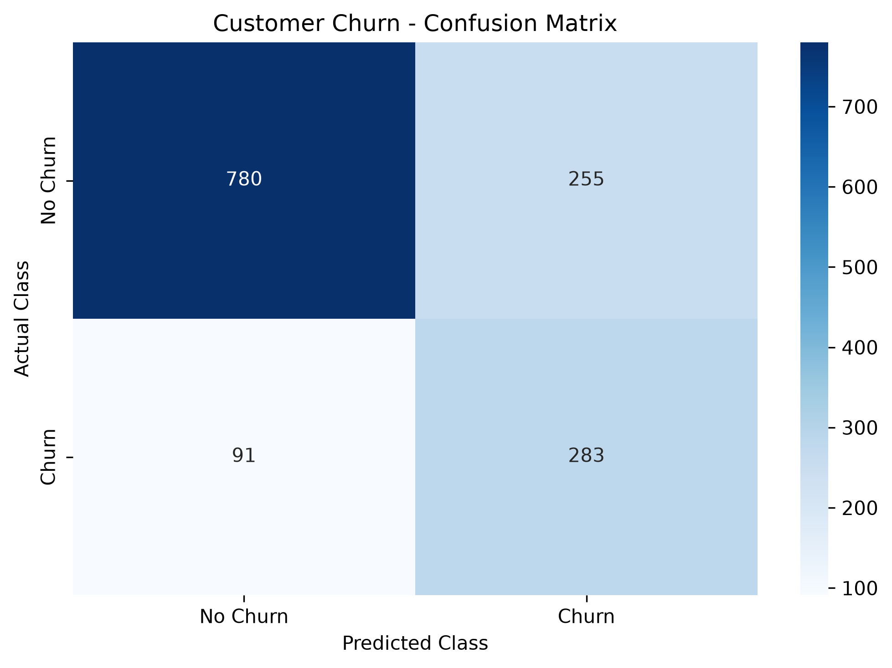
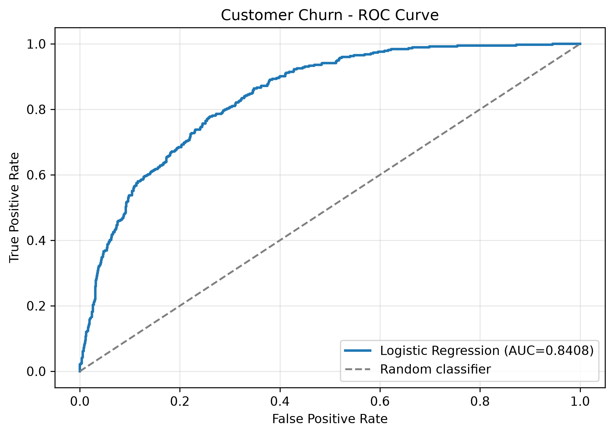

# SWYNEX Internship - Task 4
## End-to-End Machine Learning Project

A complete customer churn prediction system developed as part of the SWYNEX Technologies Data Science Internship.

The project demonstrates an end-to-end machine learning workflow covering data preprocessing, model training, evaluation, and prediction using Python and scikit-learn.

It builds on earlier internship tasks:

- [Task 1 - Dataset Exploration and Preprocessing](https://github.com/nmlandvo3-bit/SWYNEX-Dataset-Exploration-Preprocessing)
- [Task 2 - Machine Learning Model](https://github.com/nmlandvo3-bit/SWYNEX-Machine-Learning-Model)
- [Task 3 - Model Improvement](https://github.com/nmlandvo3-bit/SWYNEX-Model-Improvement)

## 1. Project Overview

Customer churn prediction is a binary classification problem that involves identifying customers who may discontinue their relationship with a telecommunications provider.

This project implements a reusable machine learning pipeline that:

1. Loads and validates customer data.
2. Prepares numerical and categorical features.
3. Trains a Logistic Regression classifier.
4. Saves the fitted preprocessing and prediction pipeline.
5. Evaluates model performance on held-out test data.
6. Generates evaluation reports and visualizations.
7. Predicts churn for new customer records.
8. Supports single-customer and batch predictions.
9. Validates inputs and exports results as JSON.

The workflow is organized into independent Python modules rather than relying on a single notebook.

## 2. Dataset

Dataset: IBM Telco Customer Churn

The project uses the same dataset as the earlier SWYNEX internship tasks.

| Property | Value |
|---|---:|
| Customer records | 7,043 |
| Original columns | 21 |
| Model input features | 19 |
| Transformed features | 46 |
| Training records | 5,634 |
| Testing records | 1,409 |
| Customers who churned | 1,869 |
| Customers who did not churn | 5,174 |

Target variable: `Churn`

Target encoding:

- No = 0
- Yes = 1

The dataset contains categorical and numerical customer information, including tenure, service subscriptions, contract type, and billing information.

## 3. Technologies

- Python 3.14.7
- Pandas
- NumPy
- Scikit-learn
- Matplotlib
- Seaborn
- Joblib
- JSON
- Python unittest

## 4. Project Structure

```text
SWYNEX-End-to-End-ML-Project/
|
|-- data/
|   |-- raw/
|   |   `-- telco_customer_churn.csv
|   `-- sample/
|       |-- customer.json
|       `-- invalid_customer.json
|
|-- src/
|   |-- __init__.py
|   |-- preprocessing.py
|   |-- pipeline.py
|   |-- train.py
|   |-- evaluate.py
|   `-- predict.py
|
|-- models/
|   |-- customer_churn_pipeline.joblib
|   `-- training_metadata.json
|
|-- results/
|   |-- evaluation_metrics.json
|   |-- test_predictions.csv
|   |-- sample_prediction.json
|   `-- figures/
|       |-- confusion_matrix.png
|       `-- roc_curve.png
|
|-- tests/
|   `-- test_pipeline.py
|
|-- README.md
|-- requirements.txt
`-- .gitignore
```

## 5. Installation

### Clone the Repository

```bash
git clone https://github.com/nmlandvo3-bit/SWYNEX-End-to-End-ML-Project.git
cd SWYNEX-End-to-End-ML-Project
```

### Create a Virtual Environment

```bash
python -m venv .venv
```

### Activate the Environment

Windows PowerShell:

```powershell
.\.venv\Scripts\Activate.ps1
```

### Install Dependencies

```bash
python -m pip install -r requirements.txt
```

### Verify Installation

```bash
python -m pip check
```

All commands in this README should be executed from the project root directory.

## 6. Data Preprocessing

Preprocessing is implemented in `src/preprocessing.py` and `src/pipeline.py`.

The implementation:

- Excludes customer IDs and target labels from model inputs.
- Converts numerical columns to numeric values.
- Handles blank TotalCharges for zero-tenure customers.
- Treats SeniorCitizen as a categorical feature.
- Uses median imputation for numerical features.
- Applies StandardScaler to numerical columns.
- Uses most-frequent imputation for categorical columns.
- Encodes categorical features using OneHotEncoder.

The fitted preprocessing transformer is stored together with the classifier.

Preprocessing statistics are fitted only on training data.

## 7. Model Training

Training is implemented in `src/train.py`.

### Model Configuration

| Parameter | Value |
|---|---|
| Algorithm | Logistic Regression |
| Regularization C | 0.1 |
| Class weighting | balanced |
| Maximum iterations | 1,000 |
| Random state | 42 |
| Training split | 80% |
| Testing split | 20% |
| Classification threshold | 0.54 |

The model configuration was selected during Task 3 and reused for the end-to-end implementation.

### Run Training

```bash
python -m src.train
```

Training generates:

- `models/customer_churn_pipeline.joblib`
- `models/training_metadata.json`

The serialized model contains the fitted preprocessing pipeline, classifier, classification threshold, and feature schema.

Only load Joblib artifacts from trusted sources.

## 8. Model Evaluation

Evaluation is implemented in `src/evaluate.py`.

Run:

```bash
python -m src.evaluate
```

The script loads the saved model and evaluates it using the original held-out testing partition.

### Final Evaluation Results

| Metric | Score |
|---|---:|
| Accuracy | 0.754436 |
| Precision | 0.526022 |
| Recall | 0.756684 |
| F1-score | 0.620614 |
| ROC-AUC | 0.840830 |

### Confusion Matrix

| Actual / Predicted | No Churn | Churn |
|---|---:|---:|
| No Churn | 780 | 255 |
| Churn | 91 | 283 |

The model correctly identified 283 out of 374 customers who churned.

Recall reached approximately 75.67%, while precision was approximately 52.60%.

This reflects a trade-off: the model identifies more potential churners but also produces more false-positive predictions.

### Confusion Matrix Visualization



### ROC Curve



### Evaluation Outputs

- `results/evaluation_metrics.json`
- `results/test_predictions.csv`
- `results/figures/confusion_matrix.png`
- `results/figures/roc_curve.png`

## 9. Customer Churn Prediction

The prediction interface is implemented in `src/predict.py`.

It uses the saved model to predict customer churn without retraining.

### Predict a Single Customer

```bash
python -m src.predict --input data/sample/customer.json
```

### Save Predictions to JSON

```bash
python -m src.predict --input data/sample/customer.json --output results/sample_prediction.json
```

### Example Result

```json
{
    "model": "Logistic Regression",
    "customer_count": 1,
    "predictions": [
        {
            "customer_id": "DEMO-001",
            "predicted_churn": "Yes",
            "churn_probability": 0.901371,
            "no_churn_probability": 0.098629,
            "classification_threshold": 0.54
        }
    ]
}
```

The example uses a synthetic customer record.

The model estimates a 90.14% probability of churn and predicts Yes because this exceeds the classification threshold of 0.54.

These probabilities are model estimates, not guarantees of future customer behavior.

### Batch Predictions

The prediction script also accepts a JSON array containing multiple customers.

Each customer record must provide the 19 required input features.

An optional `customerID` field can be included.

### Input Validation

The prediction system rejects incomplete or invalid customer inputs, including missing required features and negative billing amounts.

## 10. Automated Testing

The project includes 14 automated tests using Python's built-in unittest framework.

Run:

```bash
python -m unittest discover -s tests -p "test_*.py" -v
```

The test suite covers:

- Dataset dimensions
- Feature schema
- Target encoding
- Missing TotalCharges handling
- Reproducible data splitting
- Saved model configuration
- Transformed feature dimensions
- Probability validity
- Evaluation reproducibility
- Single-customer predictions
- Multiple-customer predictions
- Missing feature validation
- Negative charge validation
- Unfitted pipeline construction

### Test Results

```text
Ran 14 tests in 0.109s

OK
```

All 14 tests passed during final verification.

### Syntax Verification

```bash
python -m compileall -q src tests
```

## 11. Complete Workflow

To reproduce the end-to-end project, run these commands in order:

```bash
python -m src.train
python -m src.evaluate
python -m src.predict --input data/sample/customer.json --output results/sample_prediction.json
python -m unittest discover -s tests -p "test_*.py" -v
python -m pip check
```

This sequence performs model training, evaluation, prediction, and automated verification.

## 12. Relationship to Earlier SWYNEX Tasks

Task 1 focused on dataset exploration, cleaning, preprocessing, and feature transformation.

Task 2 focused on training and comparing three classification models.

Task 3 focused on improving Logistic Regression using cross-validation, GridSearchCV, class weighting, and threshold optimization.

Task 4 integrates these concepts into a complete reusable application workflow.

Task 4 reproduces Task 3's final evaluation metrics using the same dataset split and selected model configuration.

## 13. Limitations

- The model was evaluated using one dataset and one train/test split.
- The dataset represents a specific telecommunications churn scenario.
- The testing partition was already examined during earlier internship tasks.
- The model configuration was selected in Task 3.
- High churn recall comes with lower precision and accuracy.
- Input validation does not guarantee that every value is realistic.
- Predictions are estimates and may not generalize to other customer populations.
- No deployment service or external production API is included.

## 14. Future Improvements

Possible extensions include:

- Model deployment using FastAPI or Streamlit
- A web-based customer prediction interface
- Stronger input schema validation
- Batch prediction using uploaded CSV files
- Additional model comparison
- Model calibration and monitoring
- External dataset validation
- Automated deployment and continuous integration

## 15. Conclusion

SWYNEX Task 4 successfully demonstrates an end-to-end machine learning workflow for customer churn prediction.

The project includes reproducible preprocessing, training, model persistence, evaluation, visualizations, JSON-based customer predictions, and automated tests.

The final Logistic Regression model achieved an F1-score of 0.620614 and churn recall of 75.67% on the test partition.

All 14 automated tests passed, and the full training-to-prediction workflow was verified successfully.

## Acknowledgements

- SWYNEX Technologies - Data Science Internship
- IBM - Telco Customer Churn dataset
